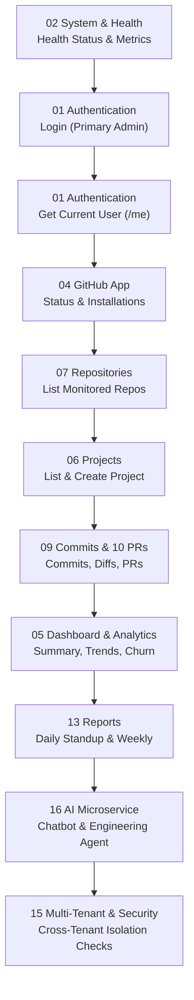

# GitMonitor API Testing & Automation Guide

Comprehensive engineering guide for importing, configuring, and executing the **GitMonitor Complete Backend & AI API Collection** via Postman.

---

## 1. Quick Start & Postman Setup

### Step 1: Import the Collection & Environments
1. Open **Postman** (Desktop application recommended or Web Agent).
2. Click the **Import** button in the top-left corner.
3. Select and import the following 3 files located in `GitHub-Backend/postman/`:
   - `GitMonitor-Complete-API.postman_collection.json`
   - `GitMonitor-Local.postman_environment.json`
   - `GitMonitor-Production.postman_environment.json`

### Step 2: Select Your Active Environment
In the upper-right environment dropdown selector in Postman:
- For local testing: Select **`GitMonitor - Local Environment`** (points to `http://localhost:5001` and `http://localhost:8000`).
- For production testing: Select **`GitMonitor - Production Environment`** (points to `https://github-project-monitoring-agent.onrender.com`).

---

## 2. Environment Variables Reference

| Variable Key | Type | Default Local Value | Description |
|---|---|---|---|
| `base_url` | default | `http://localhost:5001` | Express.js API backend base URL |
| `ai_service_url` | default | `http://localhost:8000` | Python FastAPI AI microservice base URL |
| `email` | default | `admin@betopia.com` | Primary test admin account email |
| `password` | secret | `password` | Primary test admin account password |
| `auth_token` | secret | *(auto-populated)* | Dynamic JWT access token (valid for 3 days) |
| `refresh_token` | secret | *(auto-populated)* | Dynamic JWT refresh token (valid for 30 days) |
| `user_id` | default | `usr-admin-2` | Active user identifier |
| `organization_id` | default | `org-betopia-1` | Primary tenant organization identifier |
| `secondary_email` | default | `admin1@masfiqurnehal.com` | Secondary tenant admin for multi-tenant isolation testing |
| `secondary_password` | secret | `password` | Secondary tenant password |
| `secondary_auth_token` | secret | *(auto-populated)* | JWT token for secondary tenant |
| `secondary_org_id` | default | `org-masfiqurnehal` | Secondary organization ID |
| `project_id` | default | `prj-1793187516595-a717c0` | Verified active project ID in database |
| `repository_id` | default | `repo-1373577934` | Active monitored repository (`VELQON-Frontend`) |
| `repository_url` | default | `https://github.com/MasfiqurNehal/VELQON-Frontend` | Monitored repository URL |
| `developer_id` | default | `dev-155254110` | Verified developer ID (`MasfiqurNehal`) |
| `commit_id` | default | `cmt-e3803b6c9d423aea62f26f30dbbd6eb9301c8835` | Verified commit record ID |
| `commit_sha` | default | `e3803b6c9d423aea62f26f30dbbd6eb9301c8835` | Full 40-character Git SHA |
| `pull_request_id` | default | `pr-repo-1400094389-4` | Verified pull request ID |
| `issue_id` | default | `iss-repo-1373577934-1` | Tracked GitHub issue ID |
| `installation_id` | default | `164021978` | Verified GitHub App installation ID |
| `report_id` | default | `rep-daily-today` | Target report identifier |
| `conversation_id` | default | `conv-postman-test-1` | Active AI chatbot session identifier |

---

## 3. Automated Authentication Flow

The Express API uses JSON Web Tokens (JWT) signed with a secret key.
Each login yields:
- `accessToken`: 3-day lifespan, used in `Authorization: Bearer <token>`
- `refreshToken`: 30-day lifespan, used at `POST /api/auth/refresh`

### Automated Token Capture Script
Inside **`01 Authentication & Users -> Login (Primary Admin - Betopia)`**, the **Tests** tab contains the following automated handler:

```javascript
pm.test("Status code is 200", function () {
    pm.expect(pm.response.code).to.eql(200);
});

pm.test("Token returned and extracted", function () {
    var jsonData = pm.response.json();
    pm.expect(jsonData.success).to.eql(true);
    pm.expect(jsonData.data).to.have.property('accessToken');
    pm.expect(jsonData.data).to.have.property('refreshToken');
    
    // Auto-save to both Environment and Collection variables
    pm.environment.set("auth_token", jsonData.data.accessToken);
    pm.collectionVariables.set("auth_token", jsonData.data.accessToken);
    pm.environment.set("refresh_token", jsonData.data.refreshToken);
    pm.collectionVariables.set("refresh_token", jsonData.data.refreshToken);
    
    if (jsonData.data.organizationId) {
        pm.environment.set("organization_id", jsonData.data.organizationId);
        pm.collectionVariables.set("organization_id", jsonData.data.organizationId);
    }
});
```

### Automatic Auth Inheritance
All protected folders and endpoints are configured with **Bearer Token** authentication using `{{auth_token}}`. You do **not** need to copy or paste tokens manually.

---

## 4. End-to-End Test Execution Workflow

To validate the entire platform from zero to full analytics, execute requests in this order:



### Detailed Execution Sequence:
1. **Health Verification:**
   - Run `02 System & Health -> Health Status & Metrics`. Verify `status: "healthy"` and `database: "connected"`.
2. **Authenticate:**
   - Run `01 Authentication & Users -> Login (Primary Admin - Betopia)`.
   - Verify 200 OK and that `{{auth_token}}` is populated.
3. **Verify Identity:**
   - Run `01 Authentication & Users -> Get Current Authenticated User (Me)`.
   - Inspect role (`admin`), organization (`org-betopia-1`).
4. **Inspect GitHub Connection:**
   - Run `04 GitHub App & Integration -> Get GitHub Connection Status`.
   - Run `04 GitHub App & Integration -> List Installed GitHub App Connections`.
5. **Fetch Repositories & Resources:**
   - Run `07 Repositories -> List Monitored Repositories`.
   - Auto-captures first repository into `{{repository_id}}`.
6. **Fetch Commits & Pull Requests:**
   - Run `09 Commits -> List Commits for Repository`.
   - Run `09 Commits -> Get Commit Details` & `Get Commit File Changes (Diff)`.
   - Run `10 Pull Requests -> List Pull Requests (All Repositories)`.
7. **Inspect Analytics & Intelligence:**
   - Run `05 Dashboard & Analytics -> Get Dashboard Summary`.
   - Run `05 Dashboard & Analytics -> Get Activity Trends`.
   - Run `05 Dashboard & Analytics -> Get Code Churn Analytics (Organization)`.
   - Run `05 Dashboard & Analytics -> Get AI Risk & Velocity Signals`.
8. **Inspect Generated Reports:**
   - Run `13 Reports -> Get Daily Standup Report`.
   - Run `13 Reports -> Get Weekly Engineering Report`.
9. **Execute AI Services (FastAPI):**
   - Ensure Python FastAPI is running on port 8000 (`uvicorn app.main:app --port 8000`).
   - Run `16 AI Microservice -> AI Service Health`.
   - Run `16 AI Microservice -> Chatbot Direct Chat (/api/chat)`.
   - Run `16 AI Microservice -> Engineering Agent Chat`.
10. **Execute Security & Multi-Tenant Tests:**
    - Run `15 Multi-Tenant & Security Tests -> SEC-01: Reject Access Without Token`.
    - Run `15 Multi-Tenant & Security Tests -> SEC-03: Reject Invalid Login Credentials`.
    - Run `15 Multi-Tenant & Security Tests -> SEC-04: Cross-Tenant Isolation - Access Repository With Different Tenant Token`.

---

## 5. Security & Destructive Operations Safeguards

### Multi-Tenant Isolation
GitMonitor enforces strict tenant scoping on every database query using `organizationId`. A user belonging to `org-betopia-1` cannot read, edit, or delete any resource belonging to `org-masfiqurnehal`.
- Folder **`15 Multi-Tenant & Security Tests`** provides ready-made requests that use `{{secondary_auth_token}}` to probe primary tenant resources and asserts `403 Forbidden` or `404 Not Found`.

### Destructive Operations Protection
- All `DELETE` requests in the collection are explicitly suffixed with `[DESTRUCTIVE]` in their display names.
- **Project Deletion:** `DELETE /api/projects/:id` strictly enforces admin re-authentication:
  ```json
  {
    "password": "{{password}}",
    "confirmation": true
  }
  ```
  If password is missing or incorrect, the backend rejects with `400 Bad Request` or `401 Unauthorized`.
- **Collection Runner Safety:** When running the collection using Postman Collection Runner or Newman, deselect the `[DESTRUCTIVE]` requests to prevent accidental deletion of test data.

---

## 6. Running with Newman (CLI Automated CI/CD)

You can run automated test runs in CI/CD pipelines using Newman:

```bash
# Install Newman
npm install -g newman

# Execute all tests against local backend
newman run GitHub-Backend/postman/GitMonitor-Complete-API.postman_collection.json \
  -e GitHub-Backend/postman/GitMonitor-Local.postman_environment.json \
  --folder "02 System & Health" \
  --folder "01 Authentication & Users" \
  --folder "05 Dashboard & Analytics" \
  --folder "15 Multi-Tenant & Security Tests" \
  --reporters cli,json
```

---

## 7. Troubleshooting & Common Issues

| Issue | Cause | Fix |
|---|---|---|
| `401 Unauthorized: Invalid or missing token` | `{{auth_token}}` is empty or expired | Execute `01 Authentication & Users -> Login (Primary Admin)` to refresh token |
| `connect ECONNREFUSED 127.0.0.1:5001` | Express backend is not running | Run `npm run dev` in `GitHub-Backend` directory |
| `connect ECONNREFUSED 127.0.0.1:8000` | FastAPI AI service is not running | Run `uvicorn app.main:app --port 8000` in `FastAPI-AI-Services` directory |
| `404 Not Found: Project/Repo does not exist` | ID variable does not match tenant DB | Execute `07 Repositories -> List Monitored Repositories` to dynamically load live IDs |
| `400 Bad Request: Password confirmation required` | Missing password in DELETE body | Ensure `password` field is populated with current user password |
